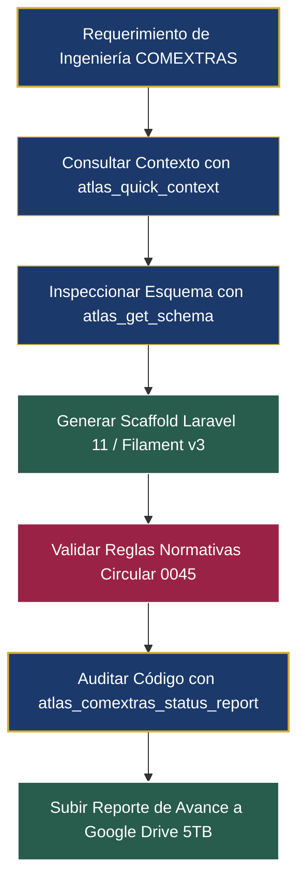

# Manual de Capacidades y Especificación Técnica
## ATLAS TECNM Knowledge Hub — Model Context Protocol (MCP)

> **Versión del Servidor:** 2.1.0  
> **Protocolo:** Anthropic Model Context Protocol (MCP) — Spec 2024-11-05  
> **Módulo Central de Enfoque:** COMEXTRAS (Comisiones al Extranjero / Formato Oficial F.37)  
> **Plataforma Objetivo:** ATLAS TecNM (Laravel 11 · Filament v3 · Neon PostgreSQL 16 · Tailwind CSS)  
> **Almacenamiento Cloud:** Google Drive 5 TB (OAuth 2.0)  
> **Repositorio Oficial:** `https://github.com/Richpol99/MCP-ATLAS-TecNM.git`  

---

## 1. Visión General y Propósito del MCP

El **ATLAS TECNM Knowledge Hub MCP Server** opera como un **agente y copiloto de ingeniería de software** especializado para el equipo de desarrollo. Su objetivo es acelerar, guiar y auditar la construcción del módulo **COMEXTRAS (F.37)** dentro del ecosistema institucional del Tecnológico Nacional de México (TecNM).

A diferencia de la aplicación web de producción (que maneja transacciones de usuarios finales), este servidor MCP funciona en el entorno de desarrollo (**Cursor, VS Code, Cline/Roo, Claude Code y Antigravity**), permitiendo:
1. **Ahorro de más del 95% de tokens de contexto:** Provee tarjetas atómicas de conocimiento de menos de 800 tokens e inspección en streaming de archivos Excel pesados (como `BASE COMEXTRAS 2026.xlsm` de 22 MB) y PDFs escaneados.
2. **Auditoría Continua de Avance en Código:** Supervisa el árbol de archivos del proyecto Laravel, mide el porcentaje real de avance y determina la siguiente prioridad técnica.
3. **Oráculo Normativo y de Negocio:** Aplica las reglas estrictas de la **Circular 0045** y del **Manual MOO-PR-039**, cálculo de días hábiles mexicanos y validación formal de identificadores fiscales (CURP y RFC).
4. **Traductor de Frontend a Filament v3:** Interpreta bocetos visuales (`.jpg`) y prototipos HTML (`Tailwind`/`Alpine.js`), adaptándolos a Resources, Widgets y Formularios institucionales con la paleta de colores oficial TecNM.
5. **Gestor Documental Autónomo en Google Drive:** Sincroniza, clasifica y respalda especificaciones técnicas, diagramas y reportes ejecutivos en la nube de 5 TB.

---

## 2. Catálogo Detallado de Capacidades (22 Herramientas MCP)

### 📊 Dominio I: Auditoría y Seguimiento de Desarrollo
* **`atlas_comextras_status_report`**
  - **Función:** Audita en tiempo real el repositorio local de ATLAS contra los 9 componentes críticos del Hito COMEXTRAS (CatPlanteles, CatPeriodos, RepRegistrosBase, ComextrasResource, migración com_solicitudes, modelo ComSolicitud, roles v2.1, Job de ingesta Excel y generador de oficios M00).
  - **Salida:** Porcentaje global ponderado, semáforo de estado (LISTO / PENDIENTE), archivo markdown local y subida automática a Google Drive.

### 🧠 Dominio II: Contexto Rápido y Búsqueda Semántica
* **`atlas_quick_context`**
  - **Función:** Genera tarjetas atómicas ultradensas (< 800 tokens) para inyectar contexto inmediato sin saturar la memoria del modelo.
  - **Tópicos cubiertos:** `comextras`, `roles_v2_1` (cargos oficiales según MOO-PR-039), `database_schemas`, `planteles_regiones`, `identidad_visual` y `roadmap_hitos`.
* **`atlas_search_knowledge`**
  - **Función:** Motor de búsqueda híbrido (semántica vectorial + BM25 con SQLite FTS5) sobre todo el acervo documental, minutas, circulares y repositorios. Retorna los 3 fragmentos más relevantes.

### ⚙️ Dominio III: Ingeniería Laravel 11 & Filament v3
* **`atlas_get_schema`**
  - **Función:** Inspecciona dinámicamente las migraciones y esquemas relacionales de la base de datos (PostgreSQL 16) retornando columnas, tipos, constraints y llaves foráneas exactas.
* **`atlas_generate_laravel_scaffold`**
  - **Función:** Genera la tríada institucional completa en código limpio:
    1. Migración DDL con timestamps y softDeletes.
    2. Modelo Eloquent con tipos de cast y scope global de aislamiento multi-tenant por `clave_plantel`.
    3. Resource de Filament v3 con esquema de formulario y columnas de tabla.
* **`atlas_get_filament_blueprint`**
  - **Función:** Genera código PHP para Filament v3 (Resources, Widgets analíticos de pulso nacional, tablas con filtros de período) configurados con la paleta oficial TecNM.
* **`atlas_get_catalog_planteles`**
  - **Función:** Consulta instantánea sobre el directorio oficial de los 263 institutos tecnológicos del país (Federales, Descentralizados OPD y Centros Especializados CRODE, CIIDET, CENIDET).
* **`atlas_check_db_health`**
  - **Función:** Diagnóstico de conexión a Neon PostgreSQL 16, auditoría de migraciones ejecutadas y validación de integridad de la caché SQLite FTS5.

### ⚖️ Dominio IV: Cumplimiento Normativo y Validación Legal
* **`atlas_get_regulatory_rule`**
  - **Función:** Consulta artículos clave de la Circular 0045 y Manual MOO-PR-039 (`anticipacion_30_dias`, `informe_30_dias`, `bloqueo_adeudo`, `oficio_m00`, `requisitos_expediente`).
* **`atlas_validate_solicitud`**
  - **Función:** Motor algorítmico que evalúa si una solicitud cumple con la regla no negociable de los 30 días hábiles previos, checklist documental (5 anexos requeridos) y bloqueo por adeudos pendientes.
* **`atlas_calculate_deadlines`**
  - **Función:** Calcula con precisión matemática las fechas límite institucionales tomando en cuenta el calendario oficial de días hábiles en México (descontando fines de semana y feriados obligatorios de ley).
* **`atlas_validate_mexican_id`**
  - **Función:** Valida la estructura y algoritmo oficial de CURP (RENAPO con entidad y dígito verificador) y RFC (SAT con homoclave) para comisionados y operadores.

### 📈 Dominio V: Ingesta y Análisis de Datos Excel Masivos
* **`atlas_inspect_excel_columns`**
  - **Función:** Inspecciona metadatos, hojas y nombres de columnas de archivos pesados (`BASE COMEXTRAS 2026.xlsm` de 22 MB y `F.37`) detectando cabeceras complejas o desplazadas sin cargar el archivo completo en memoria.
* **`atlas_sample_excel`**
  - **Función:** Muestrea filas en streaming con filtros de búsqueda textual (ej. por nombre de plantel o año) para verificar la estructura de datos sin consumir tokens innecesarios.
* **`atlas_get_f37_indicators`**
  - **Función:** Extrae métricas e indicadores trimestrales agregados del formato oficial F.37 (totales, desglose docentes vs estudiantes, tipos de evento y movilidad).

### ☁️ Dominio VI: Almacenamiento Cloud Google Drive (5 TB)
* **`atlas_drive_list`**: Lista directorios y archivos de la unidad institucional.
* **`atlas_drive_create_folder`**: Crea subdirectorios organizados.
* **`atlas_drive_move_file`**: Mueve archivos entre carpetas.
* **`atlas_drive_organize`**: Clasifica y acomoda automáticamente los archivos en los 6 directorios temáticos del proyecto.
* **`atlas_drive_read_content`**: Extrae el texto de Google Docs, PDFs y minutas para alimentar el contexto del asistente.
* **`atlas_drive_upload`**: Sube cualquier documento técnico, reporte o diagrama generado directamente a la nube mediante OAuth 2.0.
* **`atlas_sync_drive`**: Sincroniza e indexa los archivos de Drive en la base de datos de conocimiento local.

### 🎨 Dominio VII: Diagramación y Arquitectura
* **`atlas_generate_diagram`**
  - **Función:** Genera diagramas Mermaid sintácticamente válidos (ERD, Secuencia, Arquitectura, Flujo) inyectando la paleta de colores institucional:
    - **Azul TecNM:** `#1B396A`
    - **Tinto Institucional:** `#9B2247`
    - **Verde Bandera:** `#13322B`
    - **Oro TecNM:** `#D4AF37`

---

## 3. Comprensión de Frontend y Bocetos de Interfaz (UI/UX)

El servidor MCP y su agente tienen **conocimiento pleno y capacidad de análisis** sobre los bocetos del sistema, ubicados tanto en `/storage/emulated/0/proyecto TecNm/prototipo/` como en Google Drive (`05_Prototipos_e_Interfaces_UI`):

1. **Panel del Operador (`prototipo_panel_operador.jpg` / `operador.html`):**
   - Interfaz para operadores de plantel (ej. *IT Aguascalientes*).
   - Zona de arrastre de Excel (.xlsx), validación previa (Dry-Run de 3 hojas y 267 filas) y tabla de estados con badges (`VALIDADO` / `RECHAZADO`).
   - Mapeo directo a Filament v3: Componente `FileUpload` asíncrono con Livewire y Resource con filtros por trimestre.
2. **Tablero Nacional de Dirección General (`prototipo_tablero_nacional.jpg` / `dashboard.html`):**
   - 4 KPIs principales (`Participantes Intercambio`, `Planteles al día 189/263`, `COMEXTRAS 2do Trim`, `Cumplimiento 71.9%`).
   - Mapa coroplético de la República Mexicana por niveles de cumplimiento y gráficas de género / Top 5 entidades.
   - Mapeo directo a Filament v3: `StatsOverviewWidget`, widget personalizado con GeoJSON (`ECharts`/`Leaflet`) y widgets de gráfica.
3. **Acceso Institucional (`prototipo_login.jpg` / `login.html`):**
   - Autenticación centralizada con correo `@tecnm.mx` y branding PINT / TecNM.

---

## 4. Estructura de Almacenamiento en Google Drive

La carpeta raíz institucional **"Proyecto TecNM"** (`1uRgFrNP5AZUc3vq88FnjZp_SElHplrbN`) está organizada bajo el siguiente esquema temático de 6 subdirectorios:

```
📁 Proyecto TecNM (Raíz: 1uRgFrNP5AZUc3vq88FnjZp_SElHplrbN)
├── 📁 01_Normativa_y_Circulares          (ID: 1PnC9PY7ilZcchWa-NI7ksHXNPmZ5nMqp)
├── 📁 02_Bases_Datos_Excel               (ID: 1HwVV0VBqhLnM0jAKgvSD00hiCCR47vGg)
├── 📁 03_Formatos_y_Solicitudes          (ID: 1m4m1z_E4MgZHbSgBj8i0PsnbtYsFPblQ)
├── 📁 04_Presentaciones_e_Indicadores    (ID: 1EqTAUSmh329688OgIZ1j5qt5TOAD0XGX)
├── 📁 05_Prototipos_e_Interfaces_UI      (ID: 1cWf0iiapJ60QwKxi_pOZe8TmjFmwgCo0)
└── 📁 06_Documentacion_Tecnica_y_Arquitectura (ID: 1YNDsPfrxV5473c2IpGvb_JmCxJKnm9u2)
```

---

## 5. Matriz Institucional de Roles (Versión 2.1)

El MCP tiene codificada la matriz oficial de cargos según el **Manual MOO-PR-039** y **Circular 0045**, sustituyendo nomenclaturas genéricas por designaciones de ley:

| Clave | Cargo Oficial Institucional | Ámbito / Nivel | Responsabilidad en COMEXTRAS |
|---|---|---|---|
| **DG** | Dirección General del TecNM | Nacional | Firma del Oficio formal de Comisión (M00). |
| **DVEIA** | Dirección de Vinculación e Intercambio Académico | Central | Dictaminación técnica, validación de presupuestos y emisión del informe consolidado F.37. |
| **DIR_PLANTEL** | Dirección de Instituto Tecnológico (263 planteles) | Local / Plantel | Aval institucional inicial y garantía de no adeudos previos del comisionado. |
| **SUB_ACAD** | Subdirección Académica | Local / Plantel | Verificación de pertinencia académica y dictamen de academia docente. |
| **DEP_VINC** | Depto. de Gestión Tecnológica y Vinculación | Local / Plantel | Operador de captura, carga de expedientes y recepción de informes a los 30 días. |
| **COMISIONADO** | Personal Docente / Investigador / Estudiante | Individual | Beneficiario de la comisión, obligado a rendir informe en ≤30 días hábiles. |
| **OIC** | Órgano Interno de Control | Fiscalización | Auditoría posterior de viáticos, oficios M00 y bitácora inmutable (`rep_dictamenes_log`). |

---

## 6. Flujo de Trabajo Recomendado con el MCP



*(Documento generado y mantenido por el servidor atlas-knowledge-mcp v2.1)*
