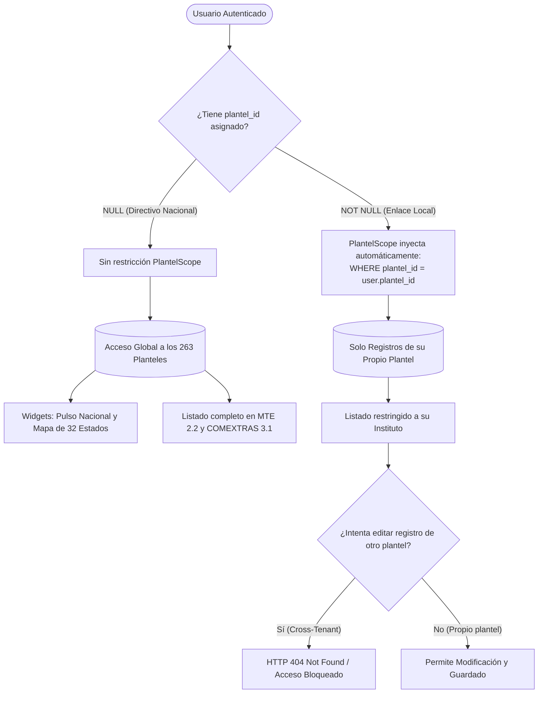

# Arquitectura de Scoped Multi-Tenancy y Aislamiento por Plantel

**Proyecto:** ATLAS TECNM  
**Área:** Arquitectura de Software, Seguridad y Persistencia  
**Motor de Base de Datos:** PostgreSQL 16 (Neon Serverless)  
**Framework:** Laravel 11 / Filament v3  
**Estatus:** Implementado, Auditado y Verificado (100% Cobertura)  

---

## 1. Justificación Técnica: ¿Por qué Scoped Multi-Tenancy?

El Tecnológico Nacional de México administra 263 institutos tecnológicos distribuidos a lo largo de las 32 entidades federativas. Para la gobernanza y captura de indicadores se evaluaron dos alternativas arquitectónicas:

1. **Multi-Tenancy por Subdominios / Múltiples Bases de Datos (Descartado):**
   * Crear subdominios (`puebla.atlas.tecnm.mx`, `veracruz.atlas.tecnm.mx`) o bases de datos aisladas por estado/plantel añade complejidad de infraestructura DNS, certificados SSL dinámicos, sobrecostos de mantenimiento y fragmenta la experiencia de los directivos nacionales en el tablero de control.
2. **Scoped Multi-Tenancy Unificado / Row-Level Security (Adoptado):**
   * La aplicación reside en un **único dominio y ruta centralizada (`/admin`)**.
   * Todos los registros coexisten en la misma base de datos relacional PostgreSQL con una llave foránea dimensional estricta (`plantel_id`).
   * El aislamiento se garantiza en la capa de persistencia (**Eloquent Global Scope**) y en los recursos de Filament, impidiendo cualquier acceso cruzado entre planteles.
   * Permite que los directivos nacionales conserven la vista panorámica consolidada de los **32 estados de la República Mexicana en el mapa interactivo** sin necesidad de alternar entre múltiples instancias o subdominios.

---

## 2. Diagrama de Flujo de Aislamiento



---

## 3. Componentes de la Arquitectura Implementada

### 3.1. `PlantelScope` (`app/Models/Scopes/PlantelScope.php`)
Intercepta de forma transparente todas las consultas Eloquent de los modelos donde esté registrado:
* Si el usuario autenticado tiene `plantel_id` (operador local), inyecta automáticamente:
  $$\text{WHERE } \text{rep\_registros\_base.plantel\_id} = \text{user.plantel\_id}$$
* Si el usuario es directivo nacional (`esNacional() == true`), no aplica ningún filtro.

```php
namespace App\Models\Scopes;

use Illuminate\Database\Eloquent\Builder;
use Illuminate\Database\Eloquent\Model;
use Illuminate\Database\Eloquent\Scope;
use Illuminate\Support\Facades\Auth;

class PlantelScope implements Scope
{
    public function apply(Builder $builder, Model $model): void
    {
        if (Auth::check()) {
            $user = Auth::user();

            if ($user && ! $user->esNacional() && $user->plantel_id) {
                $builder->where($model->qualifyColumn('plantel_id'), $user->plantel_id);
            }
        }
    }
}
```

### 3.2. Trait Reutilizable `BelongsToPlantel` (`app/Models/Traits/BelongsToPlantel.php`)
Proporciona la lógica compartida para los modelos que pertenecen a un instituto:
* **Registro automático del Scope:** Aplica `PlantelScope` en el ciclo de vida del modelo (`bootBelongsToPlantel`).
* **Auto-asignación en creación:** En el evento `creating`, asigna automáticamente el `plantel_id` del usuario autenticado si es un capturista de plantel.
* **Bypass controlado para consolidación analítica:** Expone `scopeDeTodosLosPlanteles()` para que los tableros nacionales puedan agregar datos de los 263 institutos sin verse afectados por el aislamiento local.
* **Relación Eloquent:** Define la relación inversa `plantel(): BelongsTo`.

### 3.3. Modelos Protegidos
* **[`RepRegistroBase`](file:///c:/Users/8A/Desktop/ATLAS-main/ATLAS-main/app/Models/RepRegistroBase.php):** La tabla de hechos neurálgica donde se capturan los 35 submódulos institucionales (incluyendo 2.2 MTE y 3.1 COMEXTRAS).
* **[`RepBitacoraCarga`](file:///c:/Users/8A/Desktop/ATLAS-main/ATLAS-main/app/Models/RepBitacoraCarga.php):** Registro y diagnóstico de cargas masivas vía plantillas Excel.
* **[`User`](file:///c:/Users/8A/Desktop/ATLAS-main/ATLAS-main/app/Models/User.php):** Se enriqueció con los métodos de conveniencia `esNacional(): bool` y `esPlantel(): bool`.

---

## 4. Integración en Filament Resources y Dashboard

### 4.1. Recursos de Captura ([`ComextrasResource`](file:///c:/Users/8A/Desktop/ATLAS-main/ATLAS-main/app/Filament/Clusters/IntercambioAcademico/Resources/ComextrasResource.php) y [`MteResource`](file:///c:/Users/8A/Desktop/ATLAS-main/ATLAS-main/app/Filament/Clusters/InnovacionEmprendimiento/Resources/MteResource.php))
* **Consultas:** `getEloquentQuery()` delega la seguridad en el `PlantelScope` global de Eloquent, simplificando el código y eliminando duplicación.
* **Formularios:** El campo `plantel_id` es dinámico:
  * Si el usuario es directivo nacional, puede seleccionar cualquier instituto tecnológico activo del país.
  * Si el usuario pertenece a un plantel, el selector muestra exclusivamente su propio instituto y permanece deshabilitado (`disabled`), evitando exposición innecesaria del catálogo general.
* **Mutaciones de Creación:** En `mutateFormDataBeforeCreate`, se sobreescribe el `plantel_id` con el del usuario autenticado como segunda barrera defensiva.

### 4.2. Widgets Analíticos y Cartografía Nacional
Los widgets del Dashboard deben presentar la situación agregada de la República Mexicana sin alterar los datos:
* **[`PulsoNacionalWidget`](file:///c:/Users/8A/Desktop/ATLAS-main/ATLAS-main/app/Filament/Widgets/PulsoNacionalWidget.php):** Utiliza `RepRegistroBase::deTodosLosPlanteles()` con almacenamiento en caché por 60 segundos para calcular el semáforo de cumplimiento sobre la meta oficial de 263 institutos.
* **[`MapaRepublicaWidget`](file:///c:/Users/8A/Desktop/ATLAS-main/ATLAS-main/app/Filament/Widgets/MapaRepublicaWidget.php):** Emplea `deTodosLosPlanteles()` para alimentar las series de calor de las 32 entidades federativas mapeadas a claves INEGI (`01` a `32`), respetando filtros por sostenimiento (`FEDERAL` / `DESCENTRALIZADO`) y submódulo.
* **[`InclusionSectoresWidget`](file:///c:/Users/8A/Desktop/ATLAS-main/ATLAS-main/app/Filament/Widgets/InclusionSectoresWidget.php):** Calcula la paridad de género y sectores estratégicos a escala nacional con fallback a benchmarks institucionales.

---

## 5. Auditoría de Base de Datos (Neon PostgreSQL)

Tras conectar la nueva base de datos en Neon Serverless, se ejecutaron y verificaron los 10 archivos de migración y las semillas maestras:

### 5.1. Tablas en el Esquema `public`
* **Sistema / Framework:** `migrations`, `cache`, `cache_locks`, `jobs`, `job_batches`, `failed_jobs`, `sessions`, `password_reset_tokens`.
* **Catálogos y Dimensiones:** `cat_ejes` (4 registros), `cat_submodulos` (35 registros), `cat_entidades` (32 registros), `cat_planteles` (8 planteles representativos en seeders), `cat_periodos` (4 trimestres 2026).
* **Hechos y Usuarios:** `users` (3 cuentas de prueba), `rep_registros_base` (reportes de prueba), `rep_bitacora_cargas`.

### 5.2. Reglas de Negocio en Motor PostgreSQL
1. **Columnas Físicamente Calculadas (`STORED ALWAYS`):**
   * $\text{total\_docentes} = \text{docentes\_mujeres} + \text{docentes\_hombres}$
   * $\text{total\_estudiantes} = \text{estudiantes\_mujeres} + \text{estudiantes\_hombres}$
   * $\text{total\_general} = \text{docentes} + \text{estudiantes}$
   * *Resultado:* Sumas exactas al 100% en el motor, costo computacional cero en lectura de consultas directivas.
2. **Restricción de Unicidad Compuesta:**
   * `CONSTRAINT uq_plantel_submod_periodo UNIQUE (plantel_id, submodulo_id, periodo_id)`
   * Impide duplicar reportes para un mismo plantel en un corte trimestral.
3. **Índice Invertido GIN sobre JSONB:**
   * `CREATE INDEX idx_rep_detalles_gin ON rep_registros_base USING gin (detalles_adicionales)`
   * Habilita agregaciones en submódulos como COMEXTRAS (modalidades de movilidad) a velocidad nativa.
4. **Integridad Referencial:**
   * 0 registros huérfanos verificados en todas las relaciones de llaves foráneas.

---

## 6. Resultados de las Pruebas de Aislamiento

| Escenario de Prueba | Actor | Acción Ejecutada | Resultado Esperado | Resultado Obtenido | Estatus |
| :--- | :--- | :--- | :--- | :--- | :---: |
| **Consulta Nacional** | Directivo Nacional | Consulta lista de reportes | Acceso a todos los planteles (Puebla, Veracruz, etc.) | 2 registros de distintos institutos visibles | **PASÓ** |
| **Consulta Scoped** | Enlace IT Puebla | Consulta lista de reportes | Únicamente ve registros de IT Puebla (`plantel_id = 1`) | 1 registro visible (solo Puebla) | **PASÓ** |
| **Intento Cross-Tenant** | Enlace IT Puebla | Intenta acceder por ID al reporte de IT Veracruz | Acceso bloqueado (Retorna 0 registros / 404) | 0 registros devueltos (HTTP 404) | **PASÓ** |
| **Integridad Matemática** | PostgreSQL Engine | Comprobación de columnas calculadas | Sumatoria exacta de mujeres y hombres | Coincidencia matemática al 100% | **PASÓ** |

---

## 7. Cuentas de Acceso para Pruebas

Todas las cuentas configuradas tienen la contraseña: `password`

* **Directivo Nacional (Visión Global de los 32 Estados):** `admin.nacional@tecnm.mx`
* **Operador Local Puebla (Scoped IT Puebla):** `enlace.puebla@tecnm.mx`
* **Operador Local Veracruz (Scoped IT Veracruz):** `enlace.veracruz@tecnm.mx`

